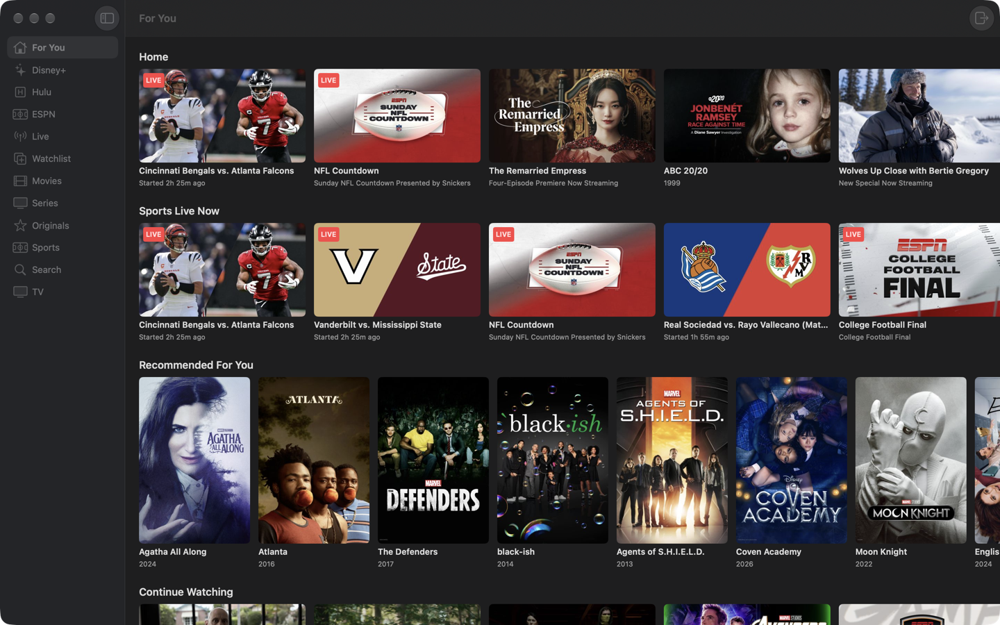

# Wazy

A personal Mac player for a Disney+ subscription, in SwiftUI.



Like Wazu (Hulu) and StarPlayrX, it talks to the service's own web API and plays natively: the
same calls disneyplus.com's player makes (the "explore" API on disney.api.edge.bamgrid.com for
browsing and search, disney.playback.edge.bamgrid.com for the stream) feed a native UI, and
AVPlayer plays the FairPlay HLS stream with keys from Disney's license server
(AVContentKeySession). Sign-in happens once on disneyplus.com in a web view (pick a profile
there too); the bearer token the site's SDK keeps is what the API client uses, and it is renewed
by reloading the site off screen when it is about to expire.

You need your own Disney+ subscription. The app stores nothing but the session token the site
itself keeps in the browser.

## Features

- Sidebar: the site's own navigation — For You, Disney+, Hulu, ESPN, Live, Watchlist, Movies,
  Series, Originals (⌘1–⌘9) and Search (⌘F); ⌘[ goes back a page
- Rows of artwork per page; series pages list seasons and episodes; a Play button resumes
- Live events and channels play from wherever they appear (ESPN, Live)
- Player: AVKit's floating controls (full screen, Picture in Picture, audio/subtitle
  menus), Play/Pause ⌘P, skip ±10 s, Stop ⌘., Esc closes; the keyboard's media keys work
- Sign-in is remembered between launches (Wazy > Sign Out of Disney+ clears it)

## Keyboard

| Shortcut | Action |
| --- | --- |
| ⌘1 – ⌘9 | Sidebar pages |
| ⌘F | Search |
| ⌘[ | Back |
| ⌘P | Play / Pause |
| ⌘← / ⌘→ | Skip back / forward 10 s |
| ⌃⌘T | Float on Top (player window) |
| ⌘. | Stop |
| Esc | Close the player |

## Requirements

- macOS 14 or later
- Xcode 15 or later
- [xcodegen](https://github.com/yonaskolb/XcodeGen) (`brew install xcodegen`) — the Xcode
  project is generated from `project.yml`
- [WazKit](https://github.com/AgentiLoop/WazKit), the Swift package shared with Wazu, cloned
  next to this folder (`project.yml` points at `../WazKit`)

## Build

```sh
git clone https://github.com/AgentiLoop/WazKit ../WazKit   # once, as a sibling of Wazy/ (this folder)
xcodegen generate
xcodebuild -project Wazy.xcodeproj -scheme Wazy -configuration Release -derivedDataPath build build
open build/Build/Products/Release/Wazy.app
```

Re-run `xcodegen generate` after adding or removing files under `Sources/`.

## WazKit

The player, its split-out window, the sign-in sheet and the artwork tiles are
[WazKit](https://github.com/AgentiLoop/WazKit); this app keeps only what is Disney+-specific.
`DisneyClient` adopts WazKit's `StreamingService` (certificate, license, and the content
identifier Disney's license server wants: the key URI's host, without `skd://`), `Item` adopts
`Tile`, and `AppModel.play` hands the player a `NowPlaying` plus the closure that calls
`client.playback(resourceId:)`:

```swift
player.play(NowPlaying(id: item.id, title: item.title, subtitle: item.subtitle)) { [client] in
    try await client.playback(resourceId: action.resourceId)
}
```

To use a different checkout of the package, change `packages.WazKit.path` in `project.yml`
(or swap it for `url: https://github.com/AgentiLoop/WazKit`, `branch: main`) and re-run
`xcodegen generate`.

## Layout

| File | Role |
| --- | --- |
| `Sources/WazyApp.swift` | App entry point, menus and keyboard shortcuts |
| `Sources/ContentView.swift` | Sidebar, pages, rows of artwork, series/episode views, the TV tab |
| `Sources/DisneyClient.swift` | The explore / playback API client (a WazKit `StreamingService`) and session handling |
| `Sources/Models.swift` | Models for the explore API responses (`Item` is a WazKit `Tile`) |
| `Sources/SignIn.swift` | disneyplus.com sign-in (WazKit `WebSignInView`) and the off-screen token refresher |
| `project.yml` | xcodegen project definition, incl. the WazKit dependency |

## Notes

- Playback is DRM-protected; screenshots and screen recordings of the player come out black.
- This is a personal project that depends on undocumented endpoints; it can break whenever the
  service changes its web player.

## License

[PolyForm Noncommercial 1.0.0](./LICENSE). You may use, modify, and share this software for noncommercial and personal purposes. Commercial use — including building or distributing commercial versions — is reserved exclusively to AgentiLoop.ai, a Logos InkPen LLC company. Contact AgentiLoop for a commercial license.
